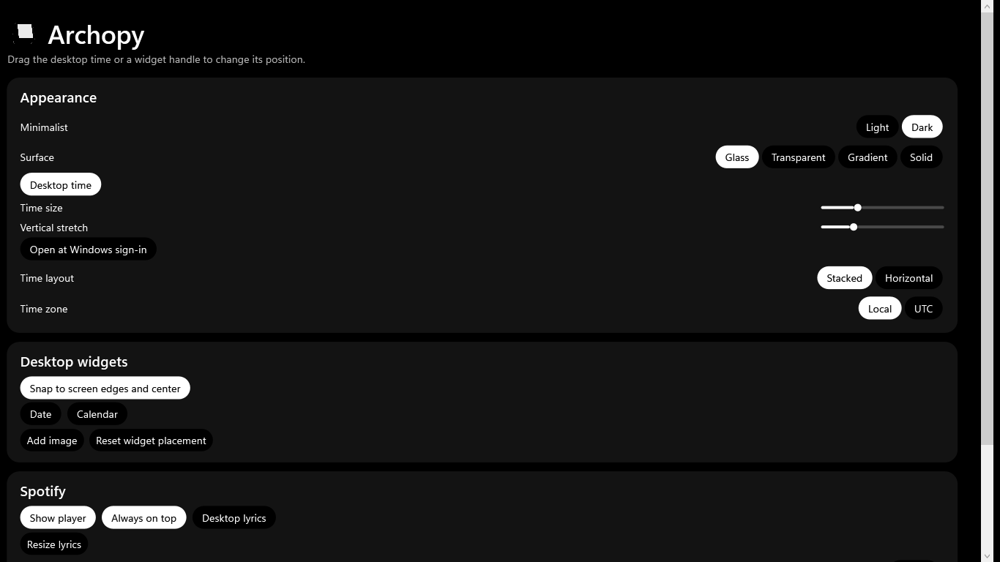

<a href="#install">Install</a> · <a href="#desktop-settings">Desktop settings</a> · <a href="#spotify-and-lyrics">Spotify and lyrics</a> · <a href="#support-and-copyright">Support</a>

<h2>About</h2>

**Known Issue**: Windows flags .EXE, this is only due to unknown publisher, not antivirus.

Archopy lets you place a clock, photo cards and a compact Spotify player over your wallpaper. Each piece can be moved independently. Settings live in the Windows notification area so your layout stays visible after you close the customiser.

<h2 id="install">Install</h2>

1. Open <strong>Releases</strong> on this repository and download <code>Archopy-Setup-x64.exe</code> from a published release. If Archopy is already running, choose <strong>Exit Archopy</strong> from its notification icon before updating.
2. Run the installer and choose <strong>Open Archopy</strong>. The installer includes the desktop runtime and installs for your Windows user account.
3. Click the Archopy icon in the Windows notification area to reopen settings. Look under the hidden-icons arrow if the icon is tucked away.

<h2 id="desktop-settings">Desktop settings</h2>

<table>
<thead><tr><th align="left">Feature</th><th align="left">What you can change</th></tr></thead>
<tbody>
<tr><td>Time</td><td>Use Windows local time or UTC, stack the digits or put them on one line. <strong>Time size</strong> scales both axes. <strong>Vertical stretch</strong> makes the digits taller or shorter.</td></tr>
<tr><td>Photos</td><td>Select <strong>Add image</strong>, then <strong>Edit image</strong>. Adjust width, height, crop zoom and crop position. Drag a framed photo’s lower-right corner to resize it. Turn off <strong>Show widget frame</strong> for just the rounded image.</td></tr>
<tr><td>Placement</td><td>Drag the time, a photo, the player’s artwork, or a widget handle. Snapping aligns windows with the edges and center of the current monitor. Date and calendar cards are optional.</td></tr>
<tr><td>Appearance</td><td>Choose Minimalist Light or Dark and a glass, transparent, gradient or solid surface. The Spotify player can stay above other apps.</td></tr>
<tr><td>Startup</td><td>Enable <strong>Open at Windows sign-in</strong> to restore your saved layout automatically. Use the same setting to turn it off.</td></tr>
</tbody></table>

View the desktop customiser

<h2 id="spotify-and-lyrics">Spotify and lyrics</h2>

Select <strong>Log in with Spotify</strong> in Archopy. Your browser opens Spotify’s consent screen. Grant permission to read playback and control your player, then return to Archopy. Start music on an active Spotify device. Playback controls require a compatible Spotify account and device.

The compact player shows track progress beside the artist and a play/pause button beside the expand arrow. Expand it to see the album, seek bar and skip controls.

Enable <strong>Desktop lyrics</strong> to look up timed lyrics automatically through LRCLIB. Position the preview, then drag its lower-right corner or choose <strong>Done</strong>. The frame disappears and the text follows the track. A taller overlay shows more lines. Use <strong>Resize lyrics</strong> to adjust it again, or <strong>Lyrics text color</strong> to match your wallpaper. Coverage varies by recording. You can also import your own LRC or TXT file for a track.

<h2 id="support-and-copyright">Support and copyright</h2>

Developed by <strong>qupix</strong>. Contact <a href="mailto:qupix.dev@proton.me">qupix.dev@proton.me</a> or find <a href="https://www.instagram.com/qupixs/">qupixs on Instagram</a>.

Copyright © 2026 qupix. Feather icons are distributed under their <a href="src/Archopy/Assets/Feather-LICENSE.txt">MIT license</a>. Spotify is a trademark of its owner. Music, artwork and lyrics belong to their respective rights holders.

<a href="docs/privacy.html">Privacy and local data</a>
